<div align="center">

# WASH Warehouse Sync

**Incremental, auditable synchronization for a single-sheet WASH groundwater infrastructure warehouse**
GPANI · WPMS · AquaWatch · Bore Logs → one verified, versioned Excel workbook

[](https://github.com/SHAYAN-ABRAR/wash-warehouse-sync/actions/workflows/ci.yml)
[](https://github.com/SHAYAN-ABRAR/wash-warehouse-sync/actions/workflows/deploy-pages.yml)
[](https://shayan-abrar.github.io/wash-warehouse-sync/)


</div>

> [!IMPORTANT]
> **The public GitHub Pages website is a demonstration and frontend distribution. Production synchronization of large private Excel warehouses runs in the local processing environment.**
> Everything on the public site is synthetic and was produced by the real engine. The site never connects to a warehouse, an engine or your computer, and never asks for tokens.
> To sync your own warehouse, run the same app on your computer — [Quick start](#quick-start-local-production), one command.

**Live demo:** https://shayan-abrar.github.io/wash-warehouse-sync/

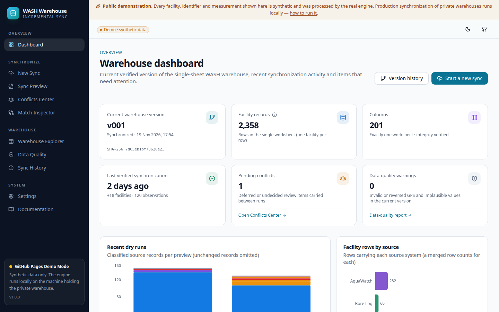

## What it does

Two inputs: **the current warehouse** and **the files to sync**. When a new GPANI, WPMS, AquaWatch or bore-log export arrives, you:

1. load the current warehouse once (step 1 of *New Sync*; the latest version is remembered, and a copy edited in Excel can be loaded again as the next version) — every page then shows it;
2. select the export(s) to sync — the source system, columns and survey year/season are detected by header name — and run a **dry run** that compares every record with the warehouse;
3. see what is **new, changed, unchanged, duplicated, conflicting or invalid** — with evidence for every match; records already in the warehouse are recognized, so nothing is added twice;
4. resolve conflicts with a recorded reason;
5. approve and apply — the engine writes a **new versioned workbook**, verifies it (including a cell-level proof that nothing else changed) and publishes it atomically;
6. download the workbook and the complete audit.

Running the same files again changes nothing: no new rows, columns, values, counts or versions.

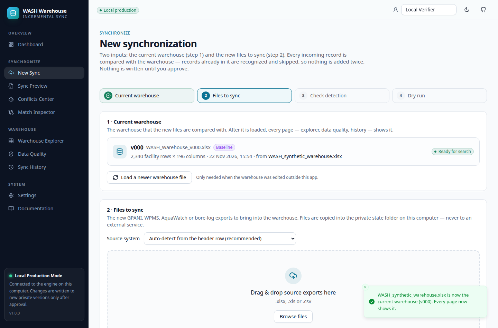
*New Sync in the app running on your computer (synthetic warehouse shown): step 1 is the current warehouse — loaded, verified and ready for search — and step 2 takes the files to sync.*

| | |
|---|---|
| 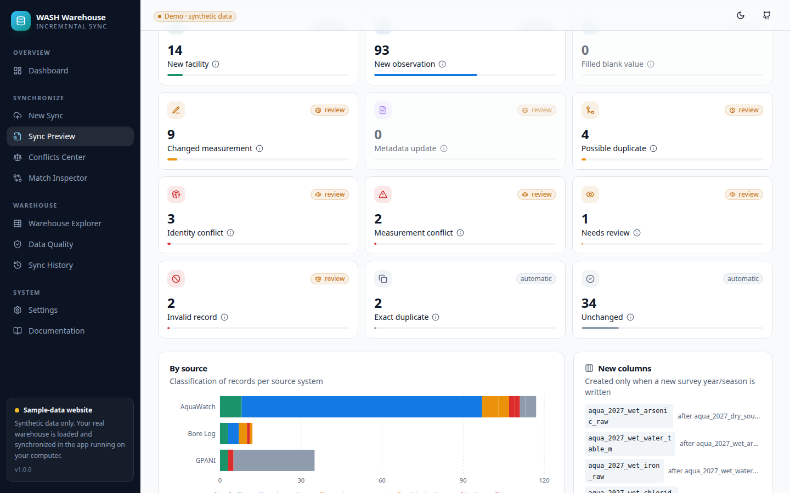 | 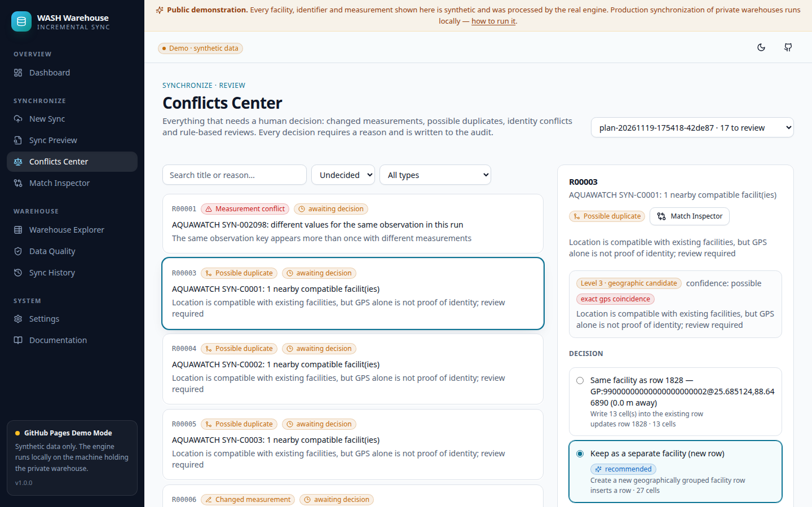 |
| **Sync Preview** — classification of every record, per source | **Conflicts Center** — decisions with required reasons |
| 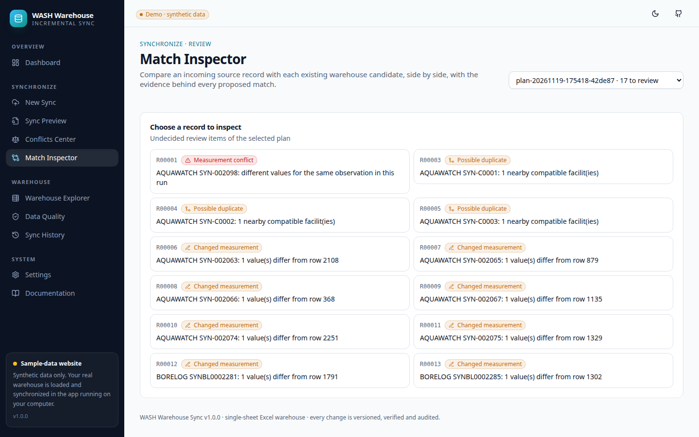 | 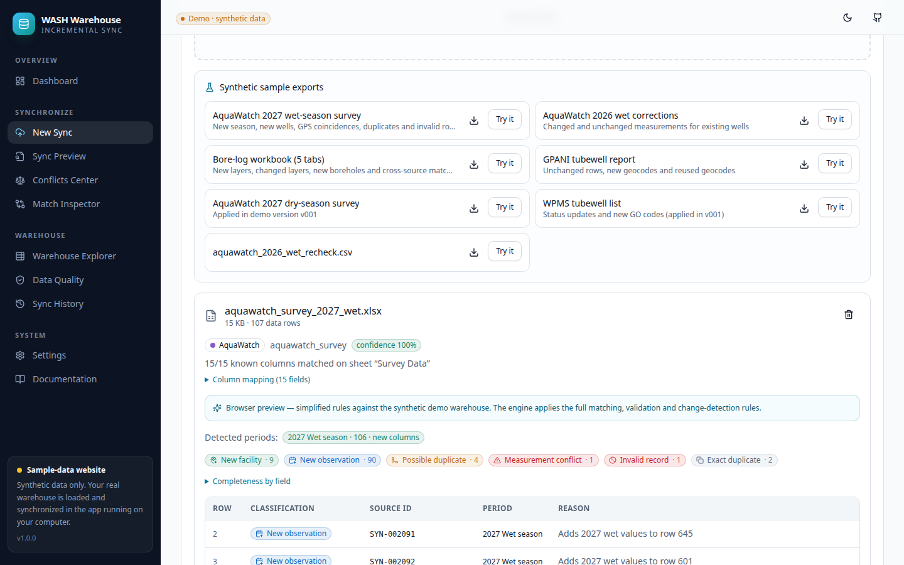 |
| **Match Inspector** — incoming record vs. warehouse candidate | **New Sync** — detection, mapping, period, completeness |
| 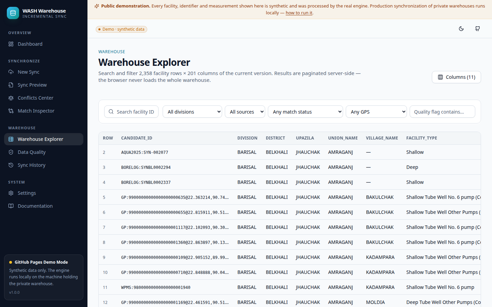 | 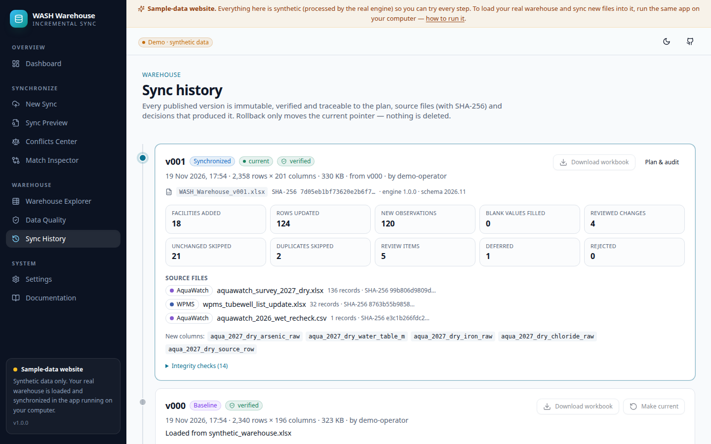 |
| **Warehouse Explorer** — server-side search, virtualized table | **Sync History** — immutable versions with integrity proofs |
| 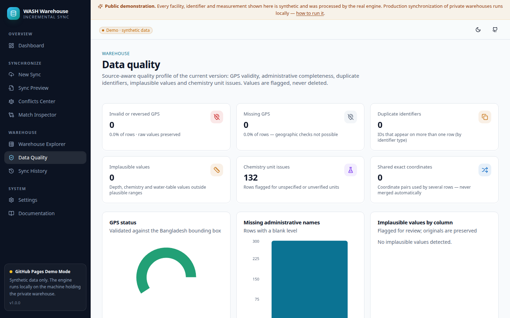 | 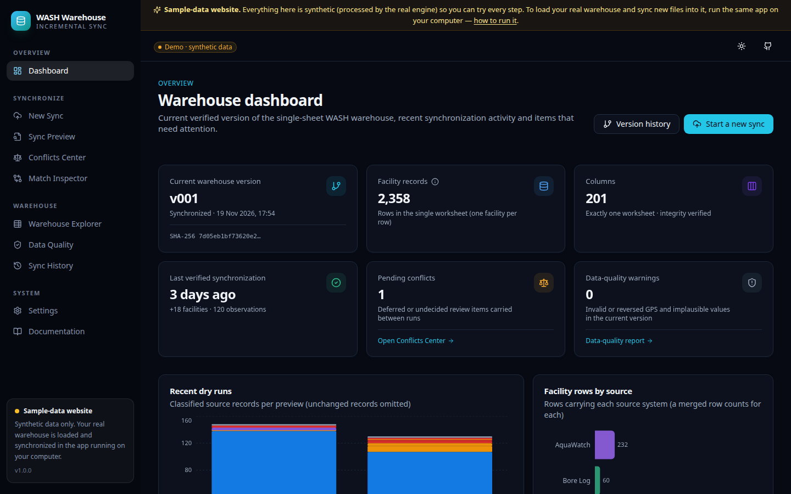 |
| **Data Quality** — GPS, completeness, outliers, units | **Dark mode** and responsive layouts |

## Features

**Engine (Python 3.12+)**
- Header-based adapters for **AquaWatch** surveys (annual and seasonal) and the historical 1986–2017 GWC table, **GPANI** tubewell and community reports, **WPMS** tubewell lists (Bangla admin names, free-text water quality) and the **five-tab bore-log** workbook (fixtures, water quality, lithology profile, surface water). Reads `.xlsx`, `.xls` and `.csv`.
- **Deterministic, explainable matching**: exact source identity → verified cross-source identity (shared code + admin + GPS + type + depth) → geographic candidates that are *never* merged without review.
- **Incremental change detection** with SHA-256 fingerprints that ignore provenance and formatting (`5.50 == 5.5`; re-ordered exports are not "new").
- **Safe updates**: new observations go into year/season columns of the existing row (new periods create new columns, placed chronologically); new facilities are inserted inside their administrative group; changed measurements always need review; blank-fills never overwrite.
- **Streaming XLSX writer** for a ~627,000 × 196 warehouse: unchanged rows are copied byte-for-byte; touched rows keep every untouched cell's XML, type and style; exactly one worksheet; Excel limits fail visibly.
- **Verification** before publishing: ZIP CRC, XML well-formedness, single sheet, row/cell order, ranges, filters, frozen header, an independent openpyxl read, and a lockstep **preservation proof** against the base version.
- **Versioning, rollback, recovery**: immutable `WASH_Warehouse_vNNN.xlsx`, atomic publish, job journals, `recover`, `rollback`.
- **Complete audit**: `sync_summary.json`, `record_changes.csv`, `matched_resources.csv`, `new_facilities.csv`, `skipped_duplicates.csv`, `validation_errors.csv`, `conflicts.csv`, `field_change_history.csv`, `report.html`.
- **Source-aware validation** (standard/strict, per-source completeness), unit-aware chemistry (mg/L, ppm, µg/L, ppb, censored values), GPS reversal correction, decimal commas, Bangla digits, test-record detection.

**Interface (React + TypeScript + Vite + Tailwind)**
- Dashboard, New Sync, Sync Preview, Match Inspector, Conflicts Center, Warehouse Explorer, Data Quality, Sync History, Settings and Documentation.
- Accessible Radix primitives, keyboard navigation, light/dark themes, phone-to-desktop layouts, virtualized tables, Web Worker preview.
- Two clearly labelled modes: **GitHub Pages demo** (synthetic, read-only, browser-only preview) and **Local Production Mode** (served by the engine on `127.0.0.1`).

## Architecture

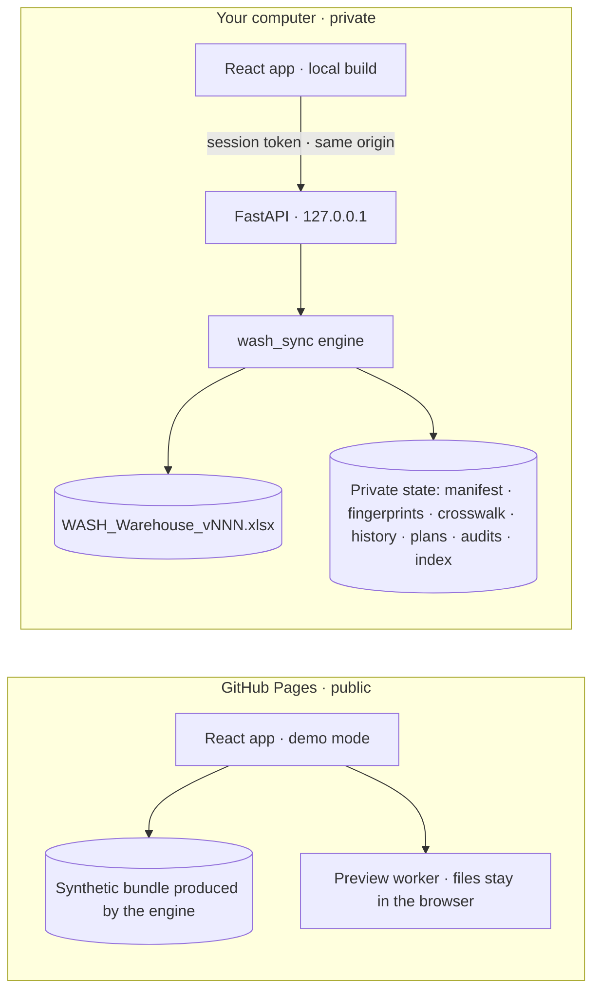

Pipeline: *source export → header-based adapter → source-aware validation → fingerprint → match (L1 → L2 → L3) → field-level diff → plan + audit → review & approve → stream-write temp workbook → verify + preservation proof → atomic publish*. Details: [docs/architecture.md](docs/architecture.md).

## Quick start (local production)

```bash
git clone https://github.com/SHAYAN-ABRAR/wash-warehouse-sync.git
cd wash-warehouse-sync
./scripts/start-local.sh --state-dir ~/wash_sync_state      # Windows: scripts\start-local.ps1
```

The launcher creates `.venv`, installs the engine, builds the interface once and opens `http://127.0.0.1:8765`. Open **New Sync**, choose your warehouse workbook in **step 1 · Current warehouse**, then add the files to sync in **step 2**. The same from the command line:

```bash
.venv/bin/wash-sync load-warehouse /path/to/WASH_GPANI_WPMS_AQUA_BORELOG_1986_2026_QA_CORRECTED.xlsx --state-dir ~/wash_sync_state
```

Manual installation, requirements and configuration: [docs/installation.md](docs/installation.md).

## Daily workflow

| Step | Web interface | Command line |
|---|---|---|
| Load the current warehouse | New Sync → 1 · Current warehouse | `wash-sync load-warehouse FILE [-r "what changed"]` |
| Inspect a file | New Sync → 2 · Files to sync | `wash-sync inspect FILE` |
| Dry run | New Sync → *Run dry-run comparison* | `wash-sync preview FILE... [--period "2027 dry"] [--strict]` |
| Review conflicts | Conflicts Center / Match Inspector | `wash-sync review list PLAN` · `review decide PLAN R00001 -d KEEP_SEPARATE -r "…"` |
| Approve | Sync Preview → *Approve plan* | `wash-sync approve PLAN` |
| Apply | Sync Preview → *Apply plan* | `wash-sync apply PLAN` (`--yes` = explicit authorization of an unapproved plan) |
| Download workbook | Sync History → *Download workbook* | `versions/WASH_Warehouse_vNNN.xlsx` in the state dir |
| Restore a version | Sync History → *Make current* | `wash-sync rollback --to N -r "…"` |
| Verify | Sync History → integrity checks | `wash-sync verify [--version N]` |
| Recover after a crash | — | `wash-sync recover` |
| Copy to private storage | — | `wash-sync publish --confirm` |

## Supported sources

| Source | Formats | Identity | Notes |
|---|---|---|---|
| AquaWatch | survey exports (`Survey Year`, `Ground Water Resource`, …), historical GWC table | resource ID; historical: ID + type + station + depth | `2026 (Wet Season)`, `2025`, `Dry 2027`; periods become `aqua_{year}[_{season}]_*` columns; historical values preserved verbatim |
| GPANI | tubewell report, community-facility report | `GP:{geocode}@{lat},{lon}` | geocode alone is not a well ID; reused geocodes go to review |
| WPMS | tubewell final list | GO code | Bangla admin names via learned mappings; water-quality text parsed |
| Bore Log | 5-tab workbook | bore-log ID; TW ID = GPANI geocode verified | lithology JSON profile, surface observations, depth units, swapped GPS |

Column aliases: [`source_profiles.json`](packages/sync_core/wash_sync/resources/source_profiles.json) · mappings: [docs/source-mappings.md](docs/source-mappings.md).

## Validation and safety rules

- Missing IDs, unrecognized periods and rows without measurements are **rejected with reasons**; warnings (GPS, type, depth, implausible chemistry, water table) are reported, and escalated to rejections in strict mode.
- Completeness rules are **per source** (bore logs have no water-table field).
- Reversed coordinates are swapped with a recorded reason; raw coordinates are kept.
- Raw chemistry readings are preserved; mg/L values are derived only from stated units; censored values never become 0.
- Changed measurements, possible duplicates and identity conflicts are **never applied without a recorded decision and reason**; undecided items are deferred.
- Plans are pinned to their base version; a FILL never overwrites; outputs are verified and atomically published.

Full rules: [docs/matching-rules.md](docs/matching-rules.md) · state and audit formats: [docs/state-and-audit.md](docs/state-and-audit.md).

## Security and privacy

- Real workbooks, source exports, audits, manifests, crosswalks and credentials are **git-ignored by default**; only small synthetic fixtures are allow-listed.
- `scripts/privacy_scan.py` checks every publishable file against identifiers loaded at runtime from a private warehouse index, and CI asserts that the demo bundle and examples are synthetic.
- Personal-data columns (caretaker names, phone numbers, staff names, accounts) are detected and never read, so they cannot reach plans, audits or the UI.
- The local API binds to `127.0.0.1`, rejects foreign Host headers, sends no CORS headers and requires a per-session token. The GitHub Pages build cannot talk to it.
- Publishing a real version elsewhere requires explicit confirmation to a configured private folder.

## Verified results

**Automated tests** (all passing at release):

| Suite | Tests |
|---|---|
| Python unit + integration + local API (`pytest`) | 141 |
| Web unit + component (`vitest`) | 28 |
| End-to-end on the production Pages build (`playwright`, desktop + mobile) — also run against the live site | 12 |

The integration suite covers initial creation, new facilities, new annual and seasonal surveys, missing-value fills, conflicting measurements, geological profile updates, existing observations, idempotent reruns, rejected GPS-only matches, workbook integrity, preservation of unrelated cells, the single worksheet, recovery after an interrupted export and geographic row ordering — and loading the current warehouse: a copy edited and re-saved the way Excel does (rows typed in, text stored as shared strings, a stale filter range) loads as the next version and takes further syncs that add rows and columns, while a source export chosen by mistake, an older copy or the already-current file are refused.

**Calibration against the real warehouse** (run privately; no data leaves the machine): every previously integrated source export across all four systems — AquaWatch surveys 2018–2026, the historical GWC table, WPMS, GPANI and bore logs — was recognized as already present (`UNCHANGED`), apart from duplicates the warehouse had already collapsed and a handful of genuinely invalid source rows. An end-to-end apply on the full ~627,000 × 196 workbook (≈800 MB of sheet XML) completed in about 4 minutes using under 300 MB of memory, passed all 14 integrity checks and proved preservation of every untouched row.

**Synthetic scale test** (`pytest -m scale`, 600,000 rows × 196 columns): passed — see [Scale test](#scale-test).

**Local production workflow through the real UI** (`apps/web/scripts/verify-local.mjs`, from an empty state): load the warehouse in step 1 (a source export picked by mistake is refused) → explorer shows it → add a file to sync → dry run → decide → approve → apply → download the workbook and audit → edit the download the way Excel would → load it as the newer warehouse → explorer, dashboard and history show it — with no console errors.

## Scale test

`pytest -m scale` generates a synthetic warehouse of **600,000 rows × 196 columns** (69.6 MB, comparable to the real
workbook), loads it, previews a 5,150-record AquaWatch export mixing every case, bulk-decides the 500 changed
measurements, applies the plan and then re-runs the same export. Measured on a 4-core laptop with a monotonic clock
(it pauses if the computer sleeps); every result in the table is asserted by the test:

| Phase | Time | Result |
|---|---|---|
| Generate the synthetic warehouse (streaming) | 56 s | 600,000 × 196, one worksheet |
| Load it as the baseline: deep verification, copy, index | 194 s | v000 |
| Dry run of 5,150 records | 10 s | 3,000 new observations · 500 new facilities · 500 changed (review) · 1,000 unchanged · 100 conflicting · 50 invalid — exactly as constructed |
| 500 bulk decisions + approve + apply (write, verify, preservation proof, then index the new version before it becomes current) | 464 s | v001: 600,500 rows, all checks passed, 600,000 base rows compared |
| Idempotent re-run | 13 s | 5,000 `UNCHANGED`; only the 100 conflicting and 50 invalid source rows remain; **no new version** |

Peak resident memory (engine plus the test harness's own copy of the synthetic wells): **427 MiB**.

## Limitations

- The browser preview on the public site uses simplified rules on synthetic data; the engine's dry run is authoritative.
- New columns are created automatically only for new AquaWatch survey periods. Other source fields absent from the warehouse schema are reported as unmapped, not added.
- The writer refuses structural edits on sheets containing formulas, merged cells, tables or conditional formats (the warehouse has none) rather than risk corrupting references.
- Bangla administrative names are translated only via mappings learned from verified rows; unmapped names are flagged for review.
- GPANI identity includes the source coordinates, so a GPS correction surfaces as an identity conflict for review.
- The historical 1986–2017 AquaWatch values remain unverified by design and are preserved verbatim.
- The local server is a single-user tool for one trusted computer; it has no multi-user accounts.
- Workbooks saved by Excel keep text in a shared-string table, which the engine holds in memory while verifying and indexing; loading such a file has been tested on synthetic warehouses, not yet on a full 627,000-row Excel save.
- "Private storage" is a verified copy to a configured folder (for example a synced organisational drive); there is no direct cloud API integration.
- The private index for a ~627k-row warehouse uses roughly 0.7 GB of disk (rebuildable cache).

## Development and tests

```bash
pip install -e ".[server,dev]"
ruff check packages tests scripts
pytest                                   # unit + integration + API
WASH_SCALE_DIR=/big/disk pytest -m scale -s   # 600k-row scale test (opt-in)

cd apps/web
npm ci
npm test                                 # Vitest
npm run build:pages                      # GitHub Pages build (demo mode)
npm run build:local                      # local production build
npx playwright install chromium && npx playwright test   # end-to-end
E2E_BASE_URL=https://shayan-abrar.github.io/wash-warehouse-sync/ npx playwright test   # against the live site
```

Regenerate the synthetic demo bundle with the real engine: `wash-sync demo-data --out apps/web/public/demo`.

## Deployment

`.github/workflows/deploy-pages.yml` builds, tests and deploys `apps/web/dist` to GitHub Pages on every push to `main` (or manually) using `configure-pages`, `upload-pages-artifact` and `deploy-pages` with `pages: write` and `id-token: write`. The Vite base is `/wash-warehouse-sync/`; every app route is written as a static copy of `index.html`, so direct visits and refreshes return 200, while unknown paths get `404.html` (the app's *Page not found* view). Details: [docs/deployment.md](docs/deployment.md) · troubleshooting: [docs/troubleshooting.md](docs/troubleshooting.md).

## Project structure

```
apps/web/                 React + TypeScript interface (pages, components, demo bundle, worker, tests, e2e)
packages/sync_core/       wash_sync engine: xlsx/, adapters/, matching, planner, apply, audit, state, cli
packages/local_api/       wash_sync_api: FastAPI local production server
tests/                    unit/, integration/, scale/
examples/                 synthetic source exports and an example settings.json
docs/                     architecture, installation, mappings, rules, state & audit, deployment, troubleshooting
scripts/                  start-local launchers, privacy scan
.github/workflows/        CI and GitHub Pages deployment
```

## License

MIT — see [LICENSE](LICENSE). The license covers the code and the synthetic demo data only.
