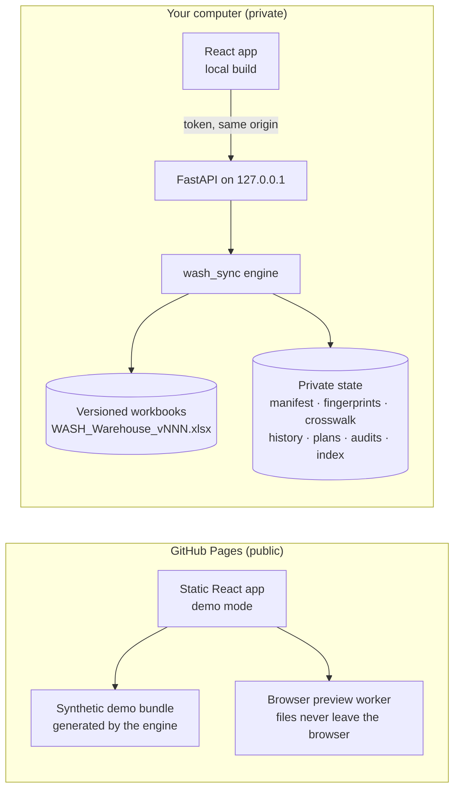
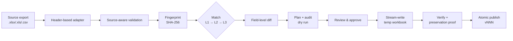

# Architecture

WASH Warehouse Sync has two complementary deployments built from one repository.

| | GitHub Pages (public) | Local production (private) |
|---|---|---|
| What runs | Static React build | Same React app (local build) + FastAPI + Python engine |
| Data | Synthetic demo bundle produced by the real engine | The private warehouse and source exports |
| Network | Static files only; never contacts an engine | `127.0.0.1` only, trusted hosts, no CORS, session token |
| Can modify a warehouse | No | Yes — only through approved plans |

## Engine pipeline

### Modules (`packages/sync_core/wash_sync`)

| Module | Responsibility |
|---|---|
| `xlsx/reader.py` | Streams the worksheet in 8 MB chunks; regex fast path per cell with a generic fallback; inline and shared strings; real progress from bytes processed. |
| `xlsx/writer.py` | Streaming rewrite: unchanged rows are copied byte-for-byte, rows below insertions are renumbered, touched rows are rebuilt keeping every untouched cell's XML. Inserts period columns, updates `<cols>`, dimension, autofilter and `_FilterDatabase`. Refuses structural edits around formulas, merged cells, tables or conditional formats. |
| `xlsx/verify.py` | ZIP CRC, XML well-formedness (expat), single worksheet, row/cell order, Excel limits, ranges, frozen header, an independent openpyxl read, and a lockstep **preservation proof** comparing the new version with its base. |
| `index.py` | One streaming pass builds a private SQLite cache (keyed by workbook SHA-256) for identity, proximity and admin-group lookups, the explorer and the data-quality profile. Always rebuildable. |
| `adapters/` | Header-based readers for AquaWatch (surveys + historical GWC table), GPANI (tubewell + community reports), WPMS and the five-tab bore-log workbook. Personal-data columns are never read. |
| `matching.py` | Deterministic three-level matching with structured evidence. |
| `changes.py` | Field policies (identity, compare, fill-only, derived, provenance, flags) and value semantics (`5.50 == 5.5`, lithology rows are provenance). |
| `planner.py` | Dry run: two passes (scan, then classify), plans new columns, insertion anchors, review items and the preview audit. |
| `apply.py` | Approval checks, operation selection, identity resolution, FILL-never-overwrites, streaming write, verification, atomic publish, ledger/crosswalk/pending updates and the apply audit. |
| `state.py` | Private state store with atomic writes and a cross-platform process lock. |
| `engine.py` / `cli.py` | Facade used by the CLI and the local API. |

## Performance design

* No spreadsheet object model: rows stay as bytes unless they change.
* Lookups use the SQLite index instead of rescanning 600k rows per record.
* Large plans are written once; decisions go to a small sidecar.
* Measured on the real ~627,000 × 196 warehouse (≈800 MB of worksheet XML): baseline registration with deep verification and indexing in under 5 minutes, a dry run of a 2,500-row survey in under 10 seconds, and a full apply (write, verification and preservation proof) in about 4 minutes, all under 300 MB of memory.

## Local API security

* Binds to `127.0.0.1`; `TrustedHostMiddleware` rejects foreign `Host` headers (DNS rebinding).
* No CORS headers; the GitHub Pages build contains no code path to a local API.
* A random per-session token is injected into the served page and required on every `/api/v1` call except `/health`.
* Uploads stay in the private state directory; downloads are limited to registered versions and allow-listed audit files.
